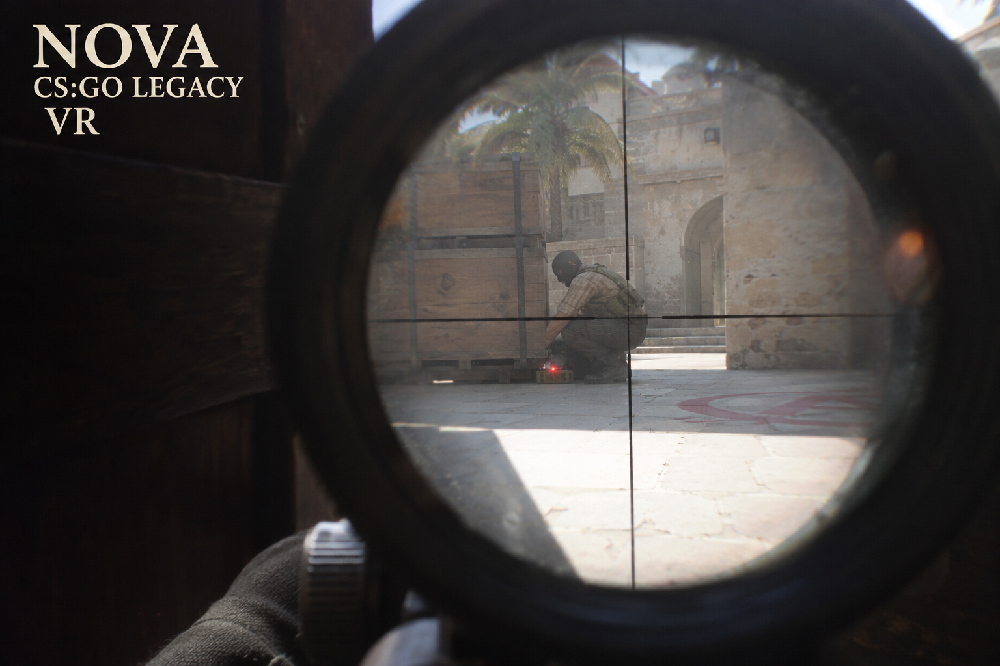

> [!IMPORTANT]
> **💬 DOWNLOAD & DISCUSSION**
>
> **[Join the Flat2VR Discord](https://discord.gg/P4q9zt7ek)** · **[Open the CS:GO VR thread](https://discord.com/channels/747967102895390741/1561970983575887952)**
>
> Use the CS:GO thread for the mod, setup help, and feedback.

  

## 📦 INSTALLATION

1. Install [**CS:GO Legacy**](https://store.steampowered.com/app/4465480/) on Steam and set `-insecure` in its launch options.
2. **Put the mod archive next to `csgo.exe`.** Extract it there and keep the entire `put me in a game folder` folder.
3. Connect PC VR, select your OpenXR runtime, and run **`RUN.bat`** from the extracted mod folder. Start a local bot match.

## ⚡ FEATURES

### GET ON TARGET WITH YOUR WEAPON HAND

Aim and fire with your motion controller in local bot matches.

### LOOK THROUGH THE OPTIC & FEEL RECOIL

Line up the AUG or AWP optic and feel the shot through controller vibration.

## 📸 In-game screenshots

  
  

[Tester credits](TESTERS.md)

## 🎮 Other VR mods

| VR mod | Highlights |
| --- | --- |
| [Alone in the Dark (2008) VR](https://github.com/Monsterdeadwood/AloneInTheDark2008VR) | Tracked item handling and hand contact with walls |
| [Battlefield 3: VRevamp](https://github.com/Monsterdeadwood/Battlefield-3-VRevamp) | Body holsters, two-handed aiming, and changing campaign skies |
| [Burnout Paradise Remastered VR](https://github.com/Monsterdeadwood/BUrnOutPvr) | Head-tracked driving with stereo boost and exhaust effects |
| [Crysis 2: VRevamp](https://github.com/Monsterdeadwood/C2VR) | Telekinesis, switchable weapon hands, and randomized weather and time of day |
| [Metro 2033 VR](https://github.com/Monsterdeadwood/Metro2033VR) | Telekinesis, hand lightning, and object physics |
| [Rainbow Six Siege VR](https://github.com/Monsterdeadwood/SiegeVR) | Tracked weapons and two-handed foregrip handling |
| [Star Wars: The Force Unleashed II VR](https://github.com/Monsterdeadwood/TFU2VR) | Independent sabers, limb cuts, Force powers, and crate flight |
| [TimeShift VR](https://github.com/Monsterdeadwood/TimeShiftVR) | Randomized weather, day and night, and roomscale crouching |
| [Titanfall 1 VR](https://github.com/Monsterdeadwood/Titanfall1VR) | Aim with the controller and look around a Titan cockpit |
| [You Are Empty: Absolute Edition VR](https://github.com/Monsterdeadwood/YouAreEmptyAEVR) | Tracked weapons and melee with either hand |
