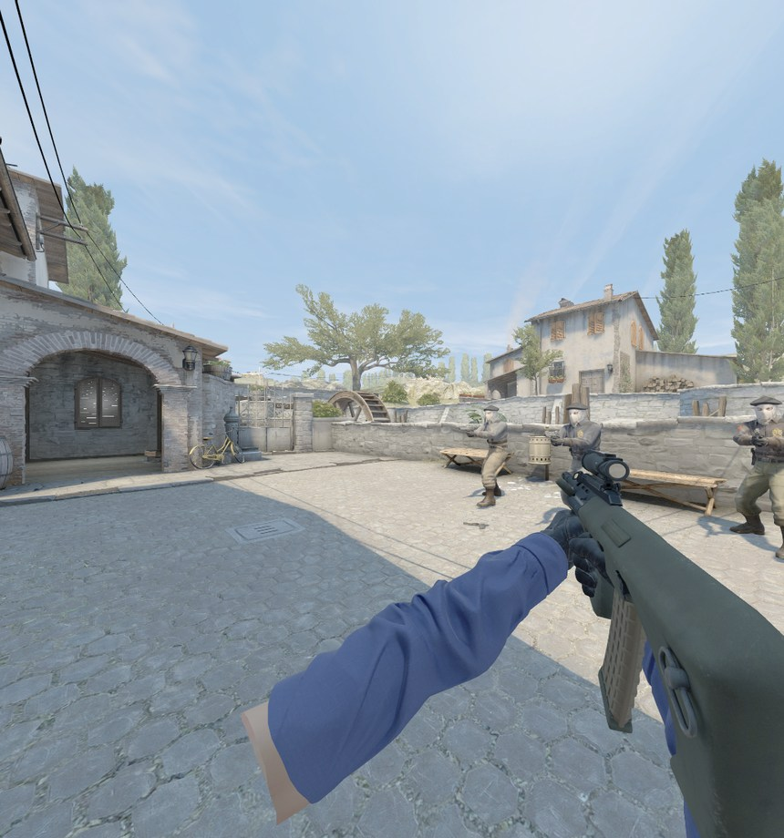

> [!IMPORTANT]
> **💬 DOWNLOAD & DISCUSSION**
>
> **[Join the Flat2VR Discord](https://discord.gg/P4q9zt7ek)** · **[Open the CS:GO VR thread](https://discord.com/channels/747967102895390741/1561970983575887952)**
>
> Use the CS:GO thread for the mod, setup help, and feedback.

  

## 📦 INSTALLATION

1. Install [**CS:GO Legacy**](https://store.steampowered.com/app/4465480/) on Steam and set `-insecure` in its launch options.
2. **Put the mod archive next to `csgo.exe`.** Extract it there and keep the entire `put me in a game folder` folder.
3. Connect PC VR, select your OpenXR runtime, and run **`RUN.bat`** from the extracted mod folder. Start a local bot match.

## ⚡ FEATURES

### 🔫 Shoot with your weapon hand and feel the recoil

Point the tracked weapon and use the trigger to fire. Shots kick the weapon and vibrate your controller.

### 🔭 Take a scoped shot with the AUG or AWP

Bring the optic up and line up the shot in your headset. Both the AUG and AWP use their in-game optics.

### 🎒 Buy gear, swap weapons and walk quietly

Open the buy menu with your right grip. Cycle or drop weapons on the controller, and hold your left grip to take a corner quietly in local bot matches.

## 📸 In-game screenshots

  
  

[Tester credits](TESTERS.md)

## 🎮 Other VR mods

| VR mod | Highlights |
| --- | --- |
| [Alone in the Dark (2008) VR](https://github.com/Monsterdeadwood/AloneInTheDark2008VR) | Aim a light by hand, carry a chair, and throw bottles |
| [Battlefield 3: VRevamp](https://github.com/Monsterdeadwood/Battlefield-3-VRevamp) | Pull dropped guns toward you, draw from body slots, and fight through changing weather |
| [Burnout Paradise Remastered VR](https://github.com/Monsterdeadwood/BUrnOutPvr) | Pull the handbrake, hit boost, and look around while racing |
| [Crysis 2: VRevamp](https://github.com/Monsterdeadwood/C2VR) | Hit enemies with your fists or weapon, throw them with telekinesis, and swap weapon hands |
| [Metro 2033 VR](https://github.com/Monsterdeadwood/Metro2033VR) | Lift an enemy, shock them with your hand, or bounce a glowing core down a tunnel |
| [Rainbow Six Siege VR](https://github.com/Monsterdeadwood/SiegeVR) | Brace a rifle by its foregrip, drop prone and use gadgets |
| [Star Wars: The Force Unleashed II VR](https://github.com/Monsterdeadwood/TFU2VR) | Ignite two sabers independently, cut limbs, and ride a crate with the Force |
| [TimeShift VR](https://github.com/Monsterdeadwood/TimeShiftVR) | Punch or hit with your weapon, control time, and fight through changing weather |
| [Titanfall 1 VR](https://github.com/Monsterdeadwood/Titanfall1VR) | Call and board a Titan, catch shots with Vortex, and eject |
| [You Are Empty: Absolute Edition VR](https://github.com/Monsterdeadwood/YouAreEmptyAEVR) | Shoot with one hand, hit with either, and reach out against walls |
