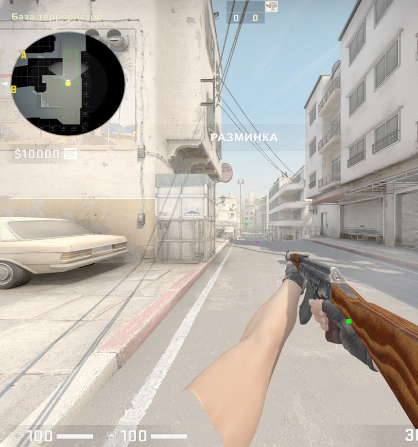
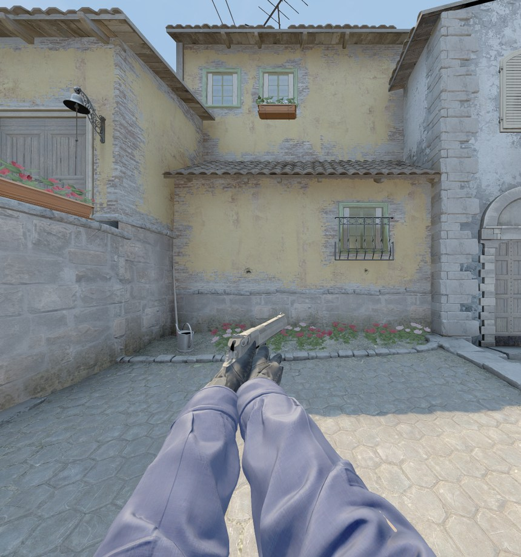

> [!IMPORTANT]
> **💬 TEST BUILDS & DISCUSSION**
>
> **[Join the Flat2VR Discord](https://discord.gg/P4q9zt7ek)** · **[Open the CS:GO VR thread](https://discord.com/channels/747967102895390741/1561970983575887952)**
>
> Download the pinned 0.12 build below. Use the Flat2VR thread for test updates and feedback.

  

## 📦 INSTALLATION

1. Install the supported [**CS:GO Legacy** Steam build](https://store.steampowered.com/app/4465480/) and set `-insecure` in its Steam launch options.
2. Extract [**csgo 0.12.zip**](release/csgo%200.12.zip?raw=1) and put **put me in a game folder** next to `csgo.exe`.
3. Connect PC VR, select your OpenXR runtime and run **`RUN.bat`**. Use a local bot match.

## ⚡ FEATURES

### CONTROLLER AIM, RECOIL & WORKING OPTICS

Aim with the right controller and feel shots through vibration. Version 0.12 includes AUG and AWP optics.

### THROW GRENADES WITH A REAL SWING

A separate development test used the motion of the right hand to throw six grenade types.

### SEAT THE MAGAZINE BY HAND

The development build seats a magazine only when it lines up with the magwell. The test covered four weapons and either hand.

The 0.12 download is for CS:GO Legacy and local bot matches. Physical grenades and magazines are separate prototypes.

## 📸 In-game screenshots

  
  

[Tester credits](TESTERS.md) · [Build details](docs/PROJECT_STATUS.md)

## 🎮 Other VR mods

| VR mod | Highlights |
| --- | --- |
| [Alone in the Dark (2008) VR](https://github.com/Monsterdeadwood/AloneInTheDark2008VR) | Tracked item handling and hand contact with walls |
| [Battlefield 3: VRevamp](https://github.com/Monsterdeadwood/Battlefield-3-VRevamp) | Body holsters, two-handed aiming, and changing campaign skies |
| [Burnout Paradise Remastered VR](https://github.com/Monsterdeadwood/BUrnOutPvr) | Head-tracked driving with stereo boost and exhaust effects |
| [Crysis 2: VRevamp](https://github.com/Monsterdeadwood/C2VR) | Physical melee, object grabbing, and a rooftop weapon range |
| [Metro 2033 VR](https://github.com/Monsterdeadwood/Metro2033VR) | Telekinesis, hand lightning, and object physics |
| [Rainbow Six Siege VR](https://github.com/Monsterdeadwood/SiegeVR) | Tracked weapons and two-handed foregrip handling |
| [Star Wars: The Force Unleashed II VR](https://github.com/Monsterdeadwood/TFU2VR) | Two tracked lightsabers and independent Force grip |
| [TimeShift VR](https://github.com/Monsterdeadwood/TimeShiftVR) | Randomized weather, day and night, and roomscale crouching |
| [Titanfall 1 VR](https://github.com/Monsterdeadwood/Titanfall1VR) | Aim with the controller and look around a Titan cockpit |
| [You Are Empty: Absolute Edition VR](https://github.com/Monsterdeadwood/YouAreEmptyAEVR) | Tracked weapons and melee with either hand |
