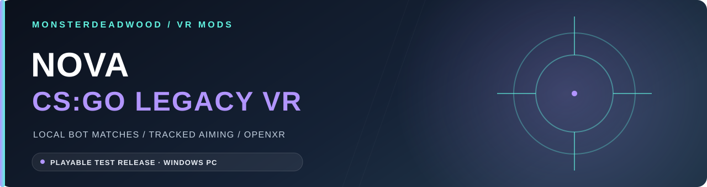

> [!IMPORTANT]
> **[TEST BUILDS & DISCUSSION · FLAT2VR DISCORD](https://discord.gg/P4q9zt7ek)**
> Testing, build requests, feedback and discussion happen in the **Flat2VR Modding Discord**. Join the server and find the **NOVA · CS:GO Legacy VR** thread.

# NOVA · CS:GO Legacy VR

[English](README.md) · [Русский](README_RU.md) · [Flat2VR Discord](https://discord.gg/P4q9zt7ek) · [All projects](PORTFOLIO.md)

NOVA brings CS:GO Legacy into VR with head tracking, a controller-driven weapon, recoil and haptics. The 0.12 release launches a local 5v5 match with nine bots through your selected OpenXR runtime.

**Current documented branch: 0.12 / NOVA-2026.10.21-F6.**

## Installation

1. Install the supported [CS:GO Steam release](https://store.steampowered.com/app/4465480/). This package targets CS:GO Legacy.
2. Download [**csgo 0.12.zip**](release/csgo%200.12.zip?raw=1) and extract it.
3. Put the complete **put me in a game folder** folder next to **csgo.exe**.
4. Connect PC VR, select its OpenXR runtime and open **RUN.bat** in the mod folder. Choose 1 for 2560 per eye or 2 for 2048.
5. Use local bot matches. The launcher applies **-insecure** and **sv_lan 1**; also add -insecure to the game’s Steam launch options.

## What this project brings to VR

- Tracked head movement and right-controller weapon aiming.
- Weapon recoil and controller vibration.
- Automatic AUG/AWP optics in the released branch.
- A local 5v5 bot-match setup, recenter and VR-accessible game menus.
- Two resolution choices and a local diagnostics ZIP after the session.

<b>Controller quick reference</b>

| Input | Action |
| --- | --- |
| Right trigger / left trigger | Fire / interact |
| Right grip / left grip | Buy menu / hold quiet walk |
| A / X | Jump / reload |
| B / Y | Cycle weapons / drop weapon |
| Left stick / click | Move / scoreboard |
| Right stick / click | Turn / crouch; stick down for quiet walk |
| Left Menu tap / hold | Recenter / game menu after 0.7 seconds |

The complete package control sheet takes precedence for its version and interaction profile.

## Current status

**Playable test release.** The released F6/0.12 build has author-reported Meta play acceptance. A tester also reported good results on VDXR; wider device coverage remains limited.

- The released left arm is not an independently tracked 6DoF hand. Some scope, audio/grenade orientation and enemy-visibility reports remain open.
- This release targets local bot matches on its pinned CS:GO build; CS2 and server connections are outside its scope.

A separate private development branch explores two-hand/either-hand carry, physical magazines, native finger grips, expanded optics and recoil. These changes do not alter the preserved F6 release.

[Detailed status and validation scope](docs/PROJECT_STATUS.md)

## Testing & feedback

Post in the game’s [Flat2VR thread](https://discord.gg/P4q9zt7ek) with your **mod version, game/store version, headset, OpenXR runtime, GPU, reproduction steps and the package’s diagnostic ZIP**. A short video is helpful for visual or handling problems.

## Other VR mods by Monsterdeadwood

| Game / project | Focus | Visibility |
| --- | --- | --- |
| [Assassin’s Creed VR](https://github.com/Monsterdeadwood/AC1VR) | First-person exploration, climbing and sword interaction | Private |
| [Crysis 2 VR](https://github.com/Monsterdeadwood/C2VR) | Nanosuit combat, physical interaction and spatial UI | Private |
| [TimeShift VR](https://github.com/Monsterdeadwood/TimeShiftVR) | Time powers, nine weapons and roomscale posture | Private |
| [You Are Empty: Absolute Edition VR](https://github.com/Monsterdeadwood/YouAreEmptyAEVR) | Absolute Edition VR, weapons and hand interaction | Public |
| [Alone in the Dark 2008 VR](https://github.com/Monsterdeadwood/AloneInTheDark2008VR) | Survival-horror VR and held-item interaction | Public |
| [Rainbow Six Siege VR](https://github.com/Monsterdeadwood/SiegeVR) | Legacy Siege stereo and tracked weapon handling | Public |
| [Burnout Paradise Remastered VR](https://github.com/Monsterdeadwood/BUrnOutPvr) | Stereo driving, vehicle menus and native effects | Private |
| [Titanfall 1 VR](https://github.com/Monsterdeadwood/Titanfall1VR) | Pilot combat and Titan cockpit VR | Private |
| [Metro 2033 VR](https://github.com/Monsterdeadwood/Metro2033VR) | Original Metro VR and native physics experiments | Public |
| [Insurgency VR](https://github.com/Monsterdeadwood/InsurgencyVR) | Early VR integration research | Private |
| [Counter-Strike: Source VR](https://github.com/Monsterdeadwood/CSSVR) | Counter-Strike: Source VR development | Private |

Private repository links are available to invited collaborators. Public project pages are marked above.

## Credits & development notes

Project maintained by [Monsterdeadwood](https://github.com/Monsterdeadwood). This is an independent fan VR project; you need your own supported copy of the original game.

[Release notes](RELEASE_NOTES.md) · [Validation](docs/VALIDATION.md) · [Building](docs/BUILDING.md) · [Known issues](KNOWN_ISSUES.md) · [Third-party notices](THIRD_PARTY.md)

[Previous repository overview, preserved as history](README_RESEARCH_ARCHIVE.md).

Documentation reviewed: **14 November 2026**.
