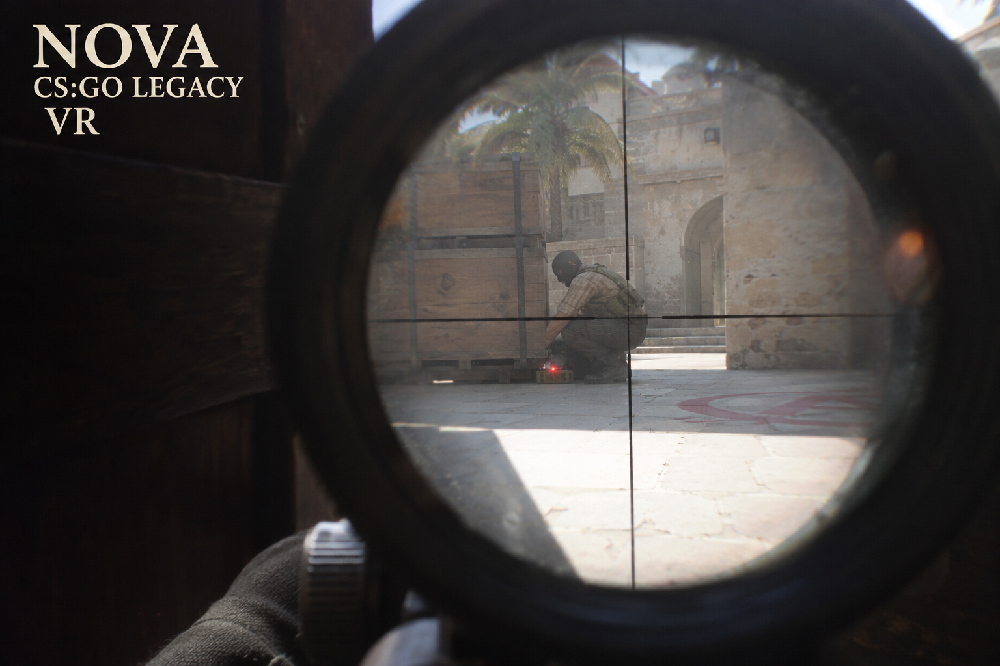

> [!IMPORTANT]
> **[ТЕСТИРОВАНИЕ И ОБСУЖДЕНИЕ · FLAT2VR DISCORD](https://discord.gg/P4q9zt7ek)**
> Тестирование, запрос сборок, отзывы и обсуждение проходят в **Flat2VR Modding Discord**. Перейди на сервер и найди тему **NOVA · CS:GO Legacy VR**.

  

# NOVA · CS:GO Legacy VR

[English](README.md) · [Русский](README_RU.md) · [Flat2VR Discord](https://discord.gg/P4q9zt7ek) · [All projects](PORTFOLIO.md)

NOVA переносит CS:GO Legacy в VR: трекинг головы, оружие от контроллера, отдача и вибрация. Версия 0.12 запускает локальный матч 5×5 с девятью ботами через выбранный OpenXR runtime.

**Текущая описанная ветка: 0.12 / NOVA-2026.10.21-F6.**

## Установка

1. Установи поддерживаемую [Steam-версию CS:GO](https://store.steampowered.com/app/4465480/). Сборка рассчитана на CS:GO Legacy.
2. Скачай и распакуй [**csgo 0.12.zip**](release/csgo%200.12.zip?raw=1).
3. Помести целую папку **put me in a game folder** рядом с **csgo.exe**.
4. Подключи PC VR, выбери OpenXR runtime и открой **RUN.bat** в папке мода. Пункт 1 — 2560 на глаз, пункт 2 — 2048.
5. Используй локальные матчи с ботами. Запуск применяет **-insecure** и **sv_lan 1**; добавь -insecure также в параметры запуска игры в Steam.

## Что есть в проекте

- Трекинг головы и прицеливание оружием от правого контроллера.
- Отдача оружия и вибрация контроллера.
- Автоматическая оптика AUG/AWP в релизной ветке.
- Локальный матч 5×5 с ботами, сброс камеры и доступ к игровому меню.
- Два варианта разрешения и локальный диагностический ZIP после сеанса.

<b>Краткое управление</b>

| Действие / кнопка | Назначение |
| --- | --- |
| Right trigger / left trigger | Огонь / взаимодействие |
| Right grip / left grip | Меню покупки / тихая ходьба при удержании |
| A / X | Прыжок / перезарядка |
| B / Y | Смена оружия / выбросить оружие |
| Left stick / click | Движение / счёт |
| Right stick / click | Поворот / присесть; вниз — тихая ходьба |
| Left Menu tap / hold | Сброс камеры / игровое меню после 0,7 секунды |

Полная инструкция управления в конкретной сборке учитывает её версию и профиль контроллеров.

## Текущий статус

**Игровая тестовая версия.** Для опубликованной F6/0.12 есть пользовательское принятие автора в Meta. Отдельный тестер сообщил о хорошем результате в VDXR; широкий набор устройств ещё не проверен.

- Левая рука в опубликованной версии не является независимой 6DoF-рукой. Открыты отдельные вопросы оптики, ориентации звука/гранат и видимости врагов.
- Версия рассчитана на локальные боты и зафиксированную сборку CS:GO; CS2 и подключения к серверам в её область не входят.

Отдельная закрытая ветка развивает двуручное и леворучное удержание, физические магазины, родные хваты пальцев, расширенную оптику и отдачу. Сохранённая версия F6 от этих изменений не меняется.

[Подробный статус и область проверки](docs/PROJECT_STATUS.md)

## Тестирование и отзывы

Напиши в [тему игры на Flat2VR](https://discord.gg/P4q9zt7ek): укажи **версию мода, игру/магазин, шлем, OpenXR runtime, GPU, шаги воспроизведения и диагностический ZIP сборки**. Для проблем изображения или управления полезно короткое видео.

<!-- COMMUNITY_TESTERS_START -->
## ❤️ Спасибо нашим тестерам!

Эти VR-проекты становятся лучше благодаря людям, которые присылают отчёты, логи, видео и практические отзывы по разным играм.

alvaro · Arkturus [CODA] · Arkturus Primacronus [HD2M] · Arthur G [ORE] · Bestgamer3 · Chtiblue · creative name [SC℧M] · Derp Dog · DNana51 [R1Δ] · Gritt [F2VR] · headbangerle. · huligan01 · jeremiasadasmki · Kerin\_Serica [1984] · kilo · Lawyer [WYRD] · little\_boxbr · Lord Beardsteak · MeWhenINameMyself · MetalikSix · neoz\_1980 · Notagameaddict · Pelmeschka · Potato Pancake Person · ReseTV · Rusty Gere · SilentBang [LTS] · SilentVortigaunt · Terry · ThE LaNd GuLl · Thomas-3D-VR · Uruz [F2VR] · Willthethrill · wxorys\_ · Xavier H. G.

[Полные благодарности: игры, авторы отзывов, совместная работа и добровольцы](TESTERS.md).

В полном списке указано, с какими играми помогал каждый участник. Спасибо также всем, чьи отчёты пришли без публичного ника.

<!-- COMMUNITY_TESTERS_END -->

## Другие мои VR-моды

| Игра / проект | Направление | Доступ |
| --- | --- | --- |
| [Assassin’s Creed VR](https://github.com/Monsterdeadwood/AC1VR) | Обзор от первого лица, лазание и меч | Закрытый |
| [Crysis 2: VRevamp](https://github.com/Monsterdeadwood/C2VR) | Нанокостюм, физическое взаимодействие и интерфейс | Открытый |
| [Star Wars: The Force Unleashed II VR](https://github.com/Monsterdeadwood/TFU2VR) | Два световых меча, телекинез каждой рукой и Сила | Открытый |
| [TimeShift VR](https://github.com/Monsterdeadwood/TimeShiftVR) | Управление временем, девять видов оружия и позы | Открытый |
| [You Are Empty: Absolute Edition VR](https://github.com/Monsterdeadwood/YouAreEmptyAEVR) | Absolute Edition в VR, оружие и взаимодействие | Открытый |
| [Alone in the Dark 2008 VR](https://github.com/Monsterdeadwood/AloneInTheDark2008VR) | VR-хоррор и взаимодействие с предметами | Открытый |
| [Rainbow Six Siege VR](https://github.com/Monsterdeadwood/SiegeVR) | Стерео и оружие от контроллеров в старой Siege | Открытый |
| [Burnout Paradise Remastered VR](https://github.com/Monsterdeadwood/BUrnOutPvr) | Стереовождение, меню автомобилей и эффекты | Открытый |
| [Titanfall 1 VR](https://github.com/Monsterdeadwood/Titanfall1VR) | Бой пилота и кабины титанов | Открытый |
| [Metro 2033 VR](https://github.com/Monsterdeadwood/Metro2033VR) | Оригинальная Metro в VR и нативная физика | Открытый |
| [Insurgency VR](https://github.com/Monsterdeadwood/InsurgencyVR) | Начальная подготовка VR-интеграции | Закрытый |
| [Counter-Strike: Source VR](https://github.com/Monsterdeadwood/CSSVR) | Разработка VR для Counter-Strike: Source | Закрытый |

Ссылки на закрытые репозитории доступны приглашённым участникам. Открытые страницы отмечены в таблице.

## Авторство и заметки разработки

Проект ведёт [Monsterdeadwood](https://github.com/Monsterdeadwood). Это независимый фанатский VR-проект; нужна собственная поддерживаемая копия оригинальной игры.

[Release notes](RELEASE_NOTES.md) · [Validation](docs/VALIDATION.md) · [Building](docs/BUILDING.md) · [Known issues](KNOWN_ISSUES.md) · [Third-party notices](THIRD_PARTY.md)

[Прежний обзор репозитория, сохранённый как история](README_RESEARCH_ARCHIVE.md).

Описание сверено: **14 ноября 2026 года**.
